<!-- Project Header -->
<div align="center">
  <h1>📊 Customer Canvas</h1>
  <h2>Where Behaviour Becomes Insight. 🧠</h2>
</div>

---


<p align="center">
  
  
  
  
  
  
</p>

---

## 📖 Project Description

**Customer Canvas** is a customer analytics and exploratory data analysis project that transforms real-world retail transactions into actionable business insights using Python and SQL.

It combines data cleaning, exploratory data analysis (EDA), RFM customer segmentation, repeat-purchase analysis, cohort retention analysis, and PostgreSQL querying to investigate customer behaviour, revenue contribution, purchasing patterns, and retention.

The project answers key business questions:

- Who are the highest-value customers?
- How much revenue comes from repeat buyers?
- Which products generate the most revenue?
- How does customer retention change over time?
- Which customer segments could benefit from targeted engagement?

## ✨ Key Highlights

- 📊 End-to-end customer analytics workflow
- 🧹 Real-world transaction data cleaning
- 🧠 RFM customer segmentation
- 🔁 Repeat versus one-time customer analysis
- 📅 Cohort retention analysis
- 🗄️ PostgreSQL database integration and SQL querying
- 🏆 Top customer and product ranking
- 📈 Matplotlib and Seaborn visualizations

## 🏗️ System Architecture


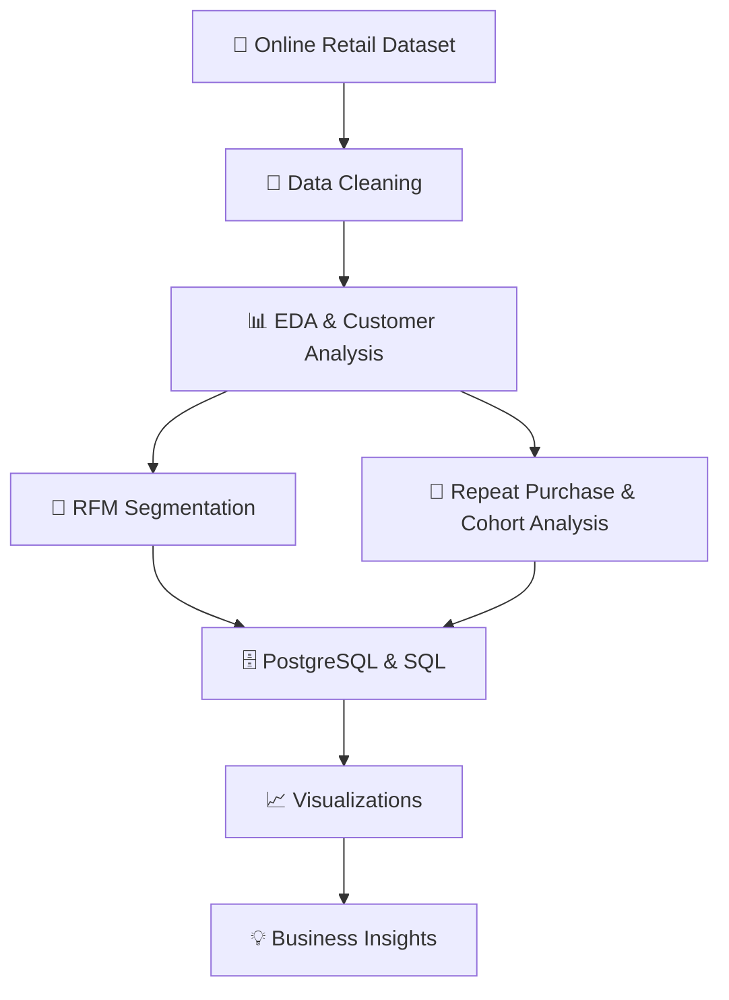


## 📊 Feature Comparison

| Feature | Manual Review | Customer Canvas |
|---|---|---|
| Data cleaning | Manual | Python and Pandas |
| Customer segmentation | Limited | RFM analysis |
| Repeat-purchase analysis | Manual | Python and SQL |
| Cohort retention | Difficult to track | Cohort analysis |
| Database querying | Not included | PostgreSQL |
| Visual reporting | Manual | Matplotlib and Seaborn |
| Customer ranking | Manual | SQL aggregation |

## ✨ Core Features

### 🧹 1. Data Cleaning

- Removed **5,268 duplicate rows**.
- Excluded cancelled invoices identified by the `C` prefix.
- Excluded non-positive quantities and unit prices from standard sales analysis.
- Created a transaction-level revenue field:

  `TotalSales = Quantity × UnitPrice`

- Prepared separate datasets for general sales analysis and identifiable customer analysis.

| Dataset | Rows | Purpose |
|---|---:|---|
| `sales_data` | 524,878 | Sales analysis, including transactions without Customer IDs |
| `customer_data` | 392,692 | Customer-level analysis |

### 📊 2. Exploratory Data Analysis

| Metric | Result |
|---|---:|
| Total sales | £10,642,110.80 |
| Identifiable customers | 4,338 |
| Unique invoices | 19,960 |
| Average order value | £533.17 |
| Average customer spending | £2,048.69 |
| Median customer spending | £668.57 |

**Monthly sales observations:**

- **Peak month:** November 2011 — £1,503,866.78.
- **Lowest month:** February 2011 — £522,545.56.
- December 2011 is incomplete, with data only through December 9.

*Note: The total sales and average order value above are from `sales_data`, which includes transactions with missing Customer IDs.*

### 🧠 3. RFM Customer Segmentation

RFM stands for:

- **Recency:** How recently a customer purchased.
- **Frequency:** How often a customer purchased.
- **Monetary:** How much a customer spent.

Customers were scored on a 1–5 scale and grouped into six segments.

| Customer Segment | Customers | Share |
|---|---:|---:|
| Hibernating | 1,072 | 24.71% |
| Champions | 941 | 21.69% |
| Others | 888 | 20.47% |
| Loyal Customers | 709 | 16.34% |
| Potential Loyalists | 514 | 11.85% |
| At Risk – Valuable | 214 | 4.93% |
| **Total** | **4,338** | **100%** |

**Key insight:** The 941 Champions generated approximately £5.74 million in revenue. The 214 At Risk – Valuable customers represent a potential target for re-engagement campaigns.

### 🔁 4. Repeat versus One-Time Customers

| Metric | Repeat Customers | One-Time Customers |
|---|---:|---:|
| Customer count | 2,845 | 1,493 |
| Share of customers | 65.58% | 34.42% |
| Average orders | 5.99 | 1.00 |
| Total revenue | £8,273,219.33 | £613,989.56 |

Repeat customers generated approximately **93.1% of combined customer-linked revenue**.

**Key insight:** Customer retention is a major business opportunity. Converting one-time buyers into repeat customers and retaining valuable existing customers could support long-term revenue.

### 📅 5. Cohort Retention Analysis

Customers were grouped by their first purchase month. Monthly retention was calculated by comparing the number of returning customers with the original cohort size.

**December 2010 cohort examples:**

| Month Since First Purchase | Retention |
|---|---:|
| Month 2 | 36.6% |
| Month 3 | 32.3% |
| Month 4 | 38.4% |
| Month 6 | 39.8% |

**Key insight:** Cohort analysis helps reveal changes in repeat purchasing over time and can inform customer engagement strategies.

*Blank cohort cells represent months that were not observed in the dataset, not zero retention.*

### 🗄️ 6. PostgreSQL and SQL Analysis

Imported **392,692 rows** into PostgreSQL and verified the row count using `COUNT(*)`.

Four SQL analyses were developed:

1. Monthly revenue aggregation.
2. Top 10 customers by revenue.
3. Repeat versus one-time customer analysis.
4. Top products by revenue.

#### 🏆 Top Customers

| Customer ID | Revenue | Orders |
|---|---:|---:|
| 14646 | £280,206.02 | 73 |
| 18102 | £259,657.30 | 60 |
| 17450 | £194,390.79 | 46 |
| 16446 | £168,472.50 | 2 |
| 14911 | £143,711.17 | 201 |

**Insight:** Customer 14646 generated the highest revenue among the returned results, while customer 16446 generated substantial revenue from only two orders.

#### 📦 Top Products by Revenue

| Product | Revenue |
|---|---:|
| PAPER CRAFT, LITTLE BIRDIE | £168,469.60 |
| REGENCY CAKESTAND 3 TIER | £142,264.75 |
| WHITE HANGING HEART T-LIGHT HOLDER | £100,547.45 |
| JUMBO BAG RED RETROSPOT | £85,040.54 |
| MEDIUM CERAMIC TOP STORAGE JAR | £81,416.73 |
| PARTY BUNTING | £68,785.23 |
| ASSORTED COLOUR BIRD ORNAMENT | £56,413.03 |

*Generic entries such as `POST` and `M` were excluded from the product-specific ranking.*

## 📸 Visualizations

Four visualizations were added to the Jupyter Notebook.

 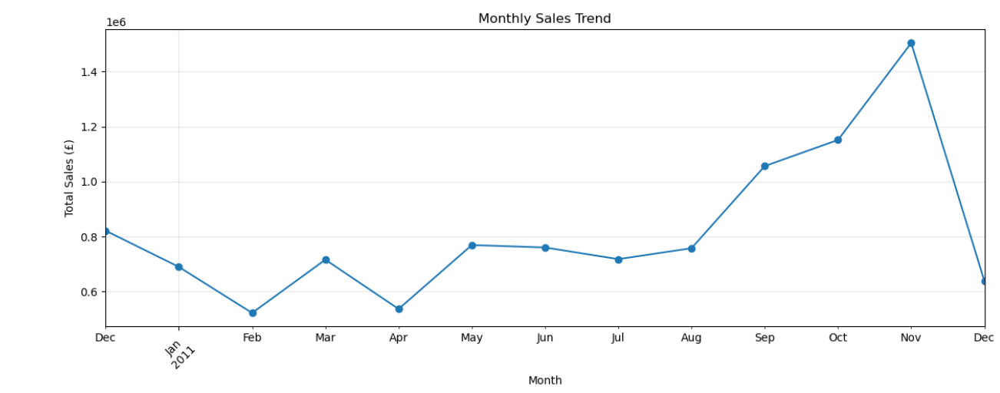
 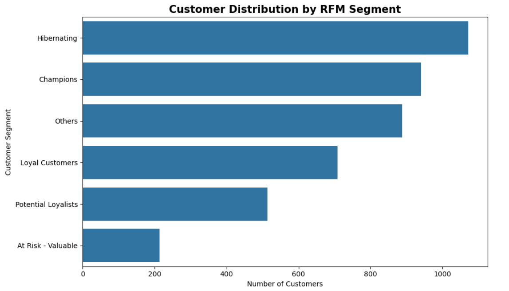
 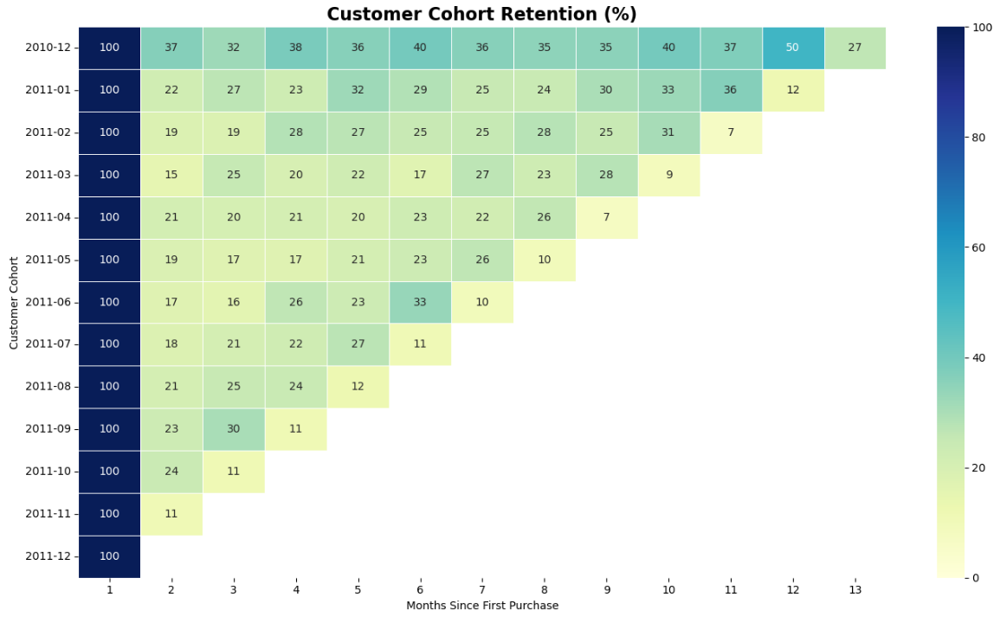
 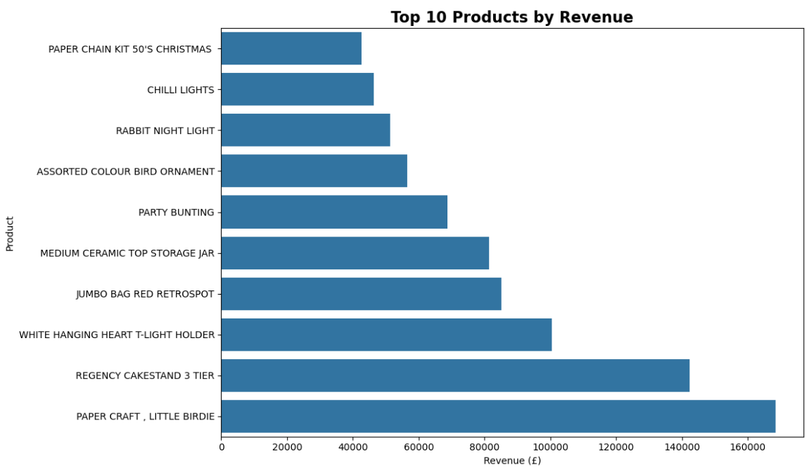

## 🛠️ Technology Stack

| Layer | Technology |
|---|---|
| Programming language | Python |
| Data processing | Pandas, NumPy |
| Visualization | Matplotlib, Seaborn |
| Database | PostgreSQL |
| Database interface | pgAdmin 4 |
| Notebook | Jupyter Notebook |
| Dataset | UCI Online Retail |

## 📂 Project Structure

```text
customer-canvas/
├── data/
│   └── Online Retail.xlsx
├── notebooks/
│   └── customer_analysis.ipynb
├── sql/
│   └── customer_analysis.sql
├── screenshots/
│   ├── monthly_revenue_trend.png
│   ├── segment_distribution.png
│   ├── cohort_heatmap.png
│   └── top_products.png
├── requirements.txt
└── README.md
```


## ⚙️ Installation and Usage

### 1. Clone the repository

```bash
git clone https://github.com/Keya3639/Customer-Canvas.git
cd Customer-Canvas
```

### 2. Install dependencies

```bash
pip install -r requirements.txt
```

### 3. Run the notebook

```bash
jupyter notebook
```

Open `customer_analysis.ipynb` and execute the cells in order.

### 4. Run the SQL analysis

- Create a PostgreSQL database named `customer_canvas`.
- Create the `customer_transactions` table.
- Import the cleaned CSV file.
- Execute the queries in `sql/customer_analysis.sql`.


## 📚 Dataset Source

**UCI Online Retail Dataset**

The dataset contains historical transactions from a UK-based online retailer between December 2010 and December 2011.

Source: https://archive.ics.uci.edu/dataset/352/online+retail

## 💡 Business Recommendations

- **Retain loyal customers:** Consider relevant loyalty rewards and exclusive offers.
- **Re-engage valuable customers:** Develop targeted campaigns for the At Risk – Valuable segment.
- **Convert one-time buyers:** Test second-purchase incentives and personalised recommendations.
- **Optimise product strategy:** Use product revenue and sales volume to inform promotional and inventory decisions.
- **Monitor customer retention:** Use cohort analysis to evaluate purchasing behaviour over time.

These are recommendations derived from the analysis; the proposed campaigns have not been experimentally tested in this project.

## 🚀 Introducing Customer Canvas 2.0 — From Customer Analytics to an Interactive Business Intelligence Dashboard!

A project that started with customer analysis has now evolved into something much more interactive. ✨

Meet Customer Canvas 2.0 — a one-page, interactive analytics workspace built to turn retail transaction data into meaningful business insights.

📊 What's new in Version 2.0?

🎨 A Modern, Dark-Themed Dashboard
A polished UI, clean layouts, intuitive sections, and interactive visualizations — because data analysis should be powerful AND beautiful.

💰 01. Executive Overview
• Total revenue and customer KPIs
• Monthly revenue trends
• Top 10 countries by revenue

📈 02. Revenue Analytics
• Average invoice value
• Average daily revenue
• Revenue by weekday
• Invoice value distribution

👥 03. Customer Segmentation — RFM Analysis
• Recency, Frequency, and Monetary analysis
• Customer segments including Champions, Loyal Customers, Potential Loyalists, At Risk, and Hibernating
• Segment distribution and customer-level insights
• Downloadable RFM analysis

🔄 04. Cohort Retention Analysis
• Track customer retention across monthly cohorts
• Interactive retention heatmap
• Explore retention data through downloadable tables

🛍️ 05. Product Intelligence
• Top 10 products by revenue
• Product-level performance analysis
• Revenue rankings with downloadable results

🔎 06. Data Explorer
• Searchable transaction-level data
• Dataset quality overview
• Missing-value checks and data-type inspection
• Exportable data for further analysis

📦 THE DATASET BEHIND THE DASHBOARD

Built using the UCI Online Retail dataset, the cleaned dataset contains:

• 392,692 transaction records
• 9 analytical columns
• 0 missing values reported after cleaning

🛠️ Tech Stack:
Python | Pandas | Streamlit | Plotly | Jupyter Notebook | SQL

💡 What I learned:

Building an analysis in a notebook is one thing. Turning that analysis into an interactive application — where users can explore trends, filter data, inspect customer segments, and download results — is a whole different experience.

Customer Canvas 2.0 brings together data cleaning, exploratory data analysis, revenue analytics, RFM segmentation, cohort retention, and product intelligence in one cohesive workspace.

And honestly? Seeing all those insights come together in a sleek, dark dashboard makes the upgrade even more satisfying. hehe 😭🖤

This is another step in my journey of building practical, insight-driven data applications — not just analyzing data, but making it easier for people to USE it.

Version 2.0 is here. More insights, more interactivity, better presentation. 🚀

## DASHBOARD 2.0 VIEW: 
---
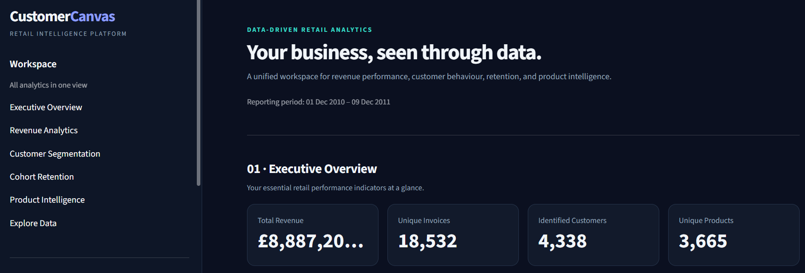
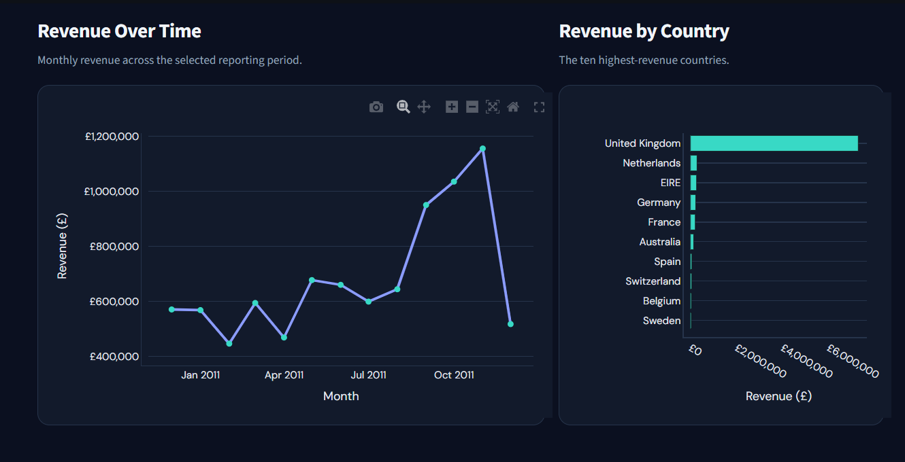
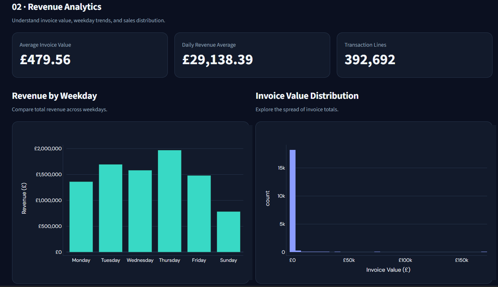
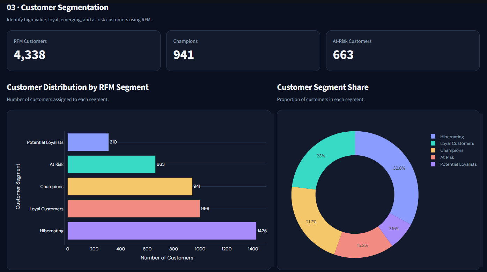
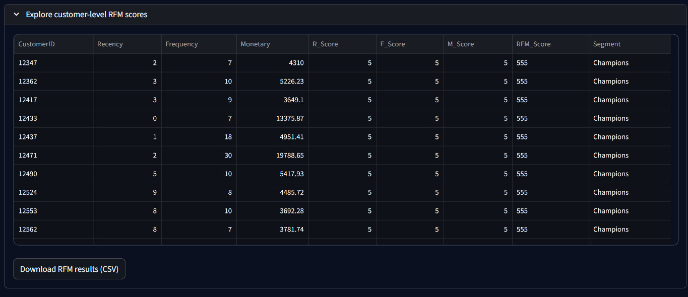
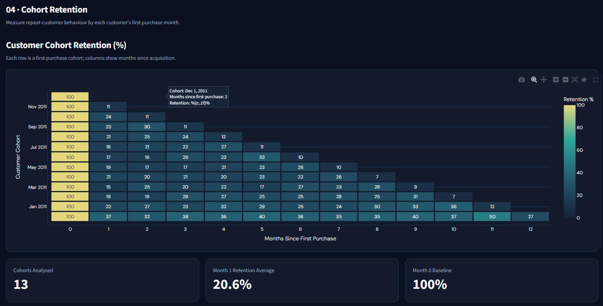
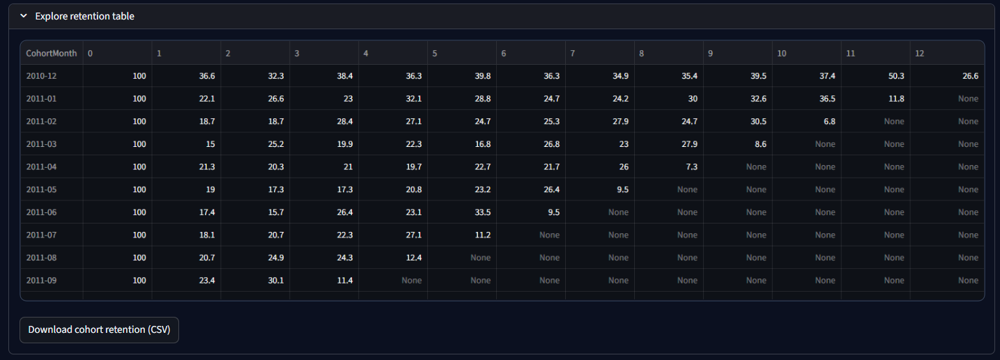
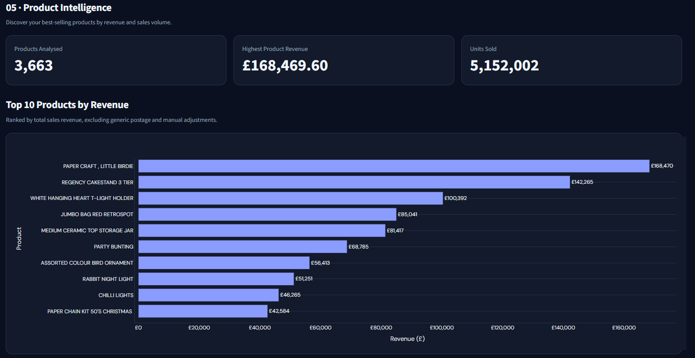
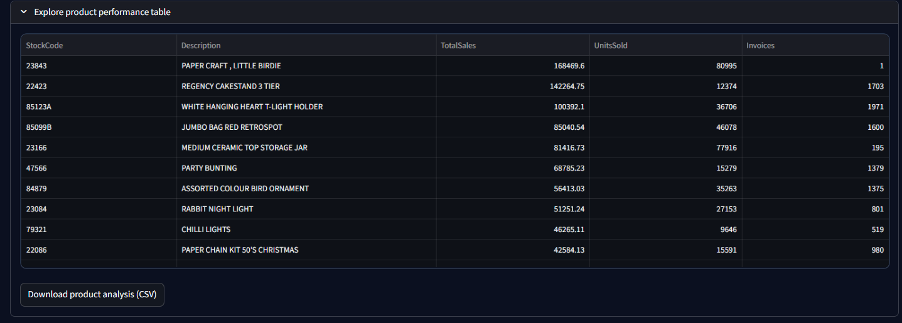
    
---
## 🌟 Why Customer Canvas?

Customer Canvas goes beyond basic sales reporting by combining customer-level behavioural analysis with SQL-based data exploration.

It demonstrates a reproducible workflow for cleaning retail transactions, understanding customer value, identifying repeat-purchase patterns, segmenting customers, and communicating findings through visualizations.

## 🎯 Project Advantages

- ⚡ Reproducible Python analysis
- 🧠 RFM-driven customer insights
- 📊 Python and SQL analysis
- 📅 Cohort retention visibility
- 🗄️ Practical PostgreSQL integration
- 📈 Visual storytelling with Matplotlib and Seaborn

## 🛣️ Project Status and Future Scope

**Core analysis:** Completed

- [x] Data cleaning
- [x] Exploratory data analysis
- [x] RFM segmentation
- [x] Cohort retention analysis
- [x] PostgreSQL import and verification
- [x] Four SQL analyses
- [x] Four notebook visualizations


**Possible future extensions:**

- Customer Lifetime Value (CLV) estimation
- Churn prediction
- Interactive BI dashboard


## 👩‍💻 Developer

**Keya Das**  
MCA Graduate — AI & Data Science

GitHub: https://github.com/Keya3639

## 📌 Conclusion

Customer Canvas demonstrates how Python and PostgreSQL can be combined to transform raw retail transactions into meaningful customer and business insights. By analysing sales trends, purchase frequency, customer value, cohort retention, and product revenue, the project provides a foundation for data-informed customer retention and retail strategy.

---

<p align="center">
  <strong>📊 Customer Canvas</strong><br/>
  <em>Where Behaviour Becomes Insight. 🧠</em><br/><br/>
  Built with ❤️ using Python • Pandas • NumPy • Seaborn • PostgreSQL • SQL • Jupyter
</p>
